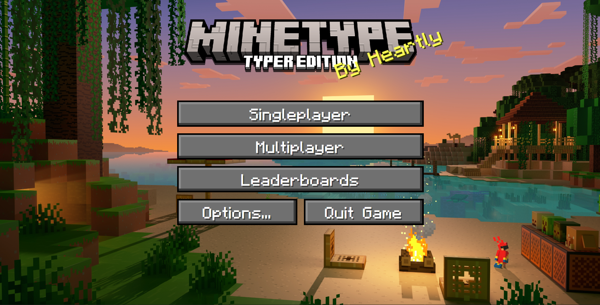
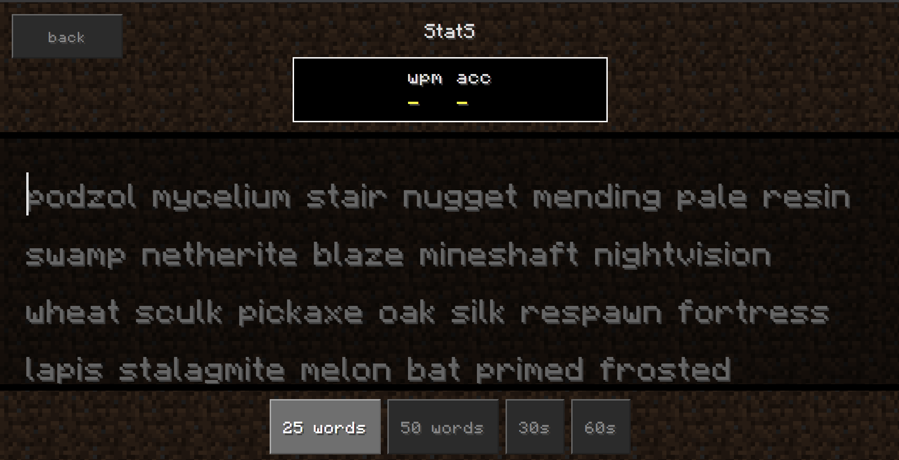
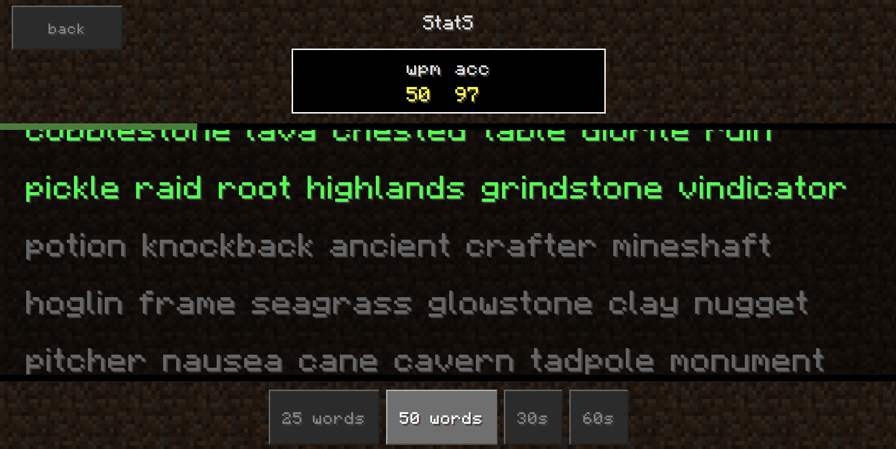
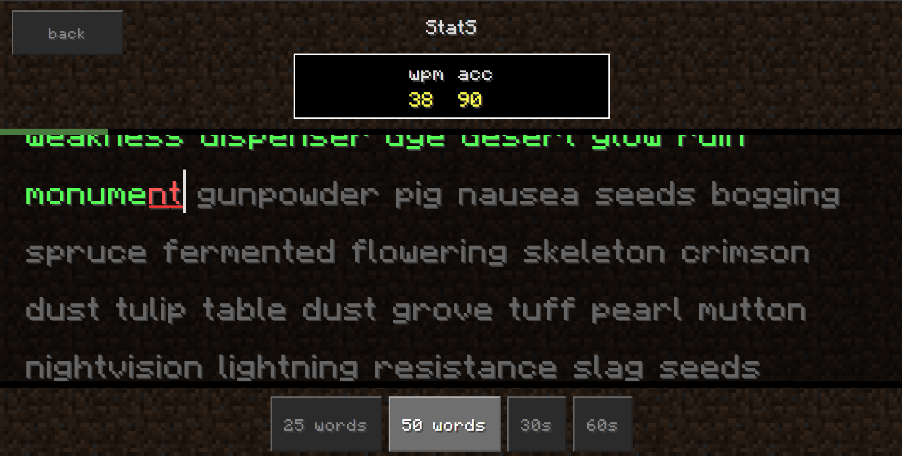
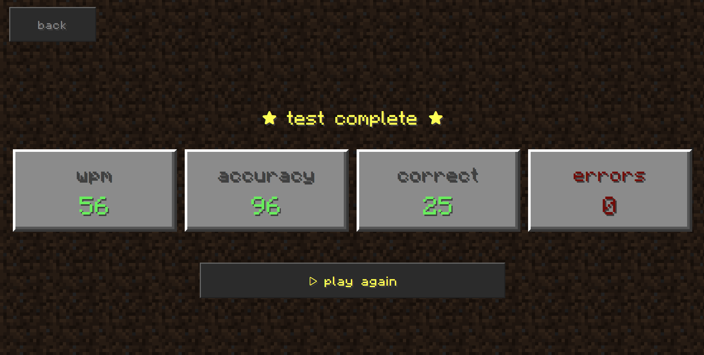
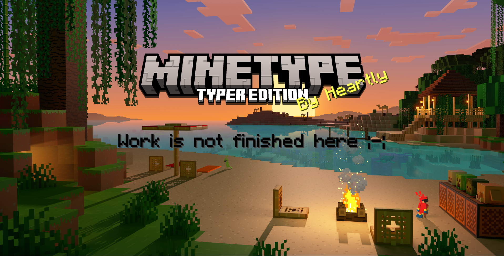

# Minetype

Minetype is a **monkey-type** like typing game in the theme of **minecraft**, it uses vocab of minecraft toooo. It also has *animated* background, mineraft *font* and even ui **"inspired"** by minecraft.

As you can see, it has 4 mode in single-player;
25 words, 50 words, 30seconds and 60 seconds  
(I think names are enough to know what they are :D )

Also some more detail:
* Words are chosen at random.
* Accuracy are calculated as:
$$\text{Accuracy (\%)} = \left( \frac{\text{Correct Keystrokes}}{\text{Total Keystrokes}} \right) \times 100$$
* Words Per Minute is calculated as:
$$\text{WPM} = \frac{\text{Total Correct Characters} / 5}{\text{Elapsed Time in Minutes}}$$
* Correct is calcualted as the no. of correctly typed words
* Error is calcualted as the no. of misspelled words

 

There is also a page which opens if you press other thing instead of single-player:
